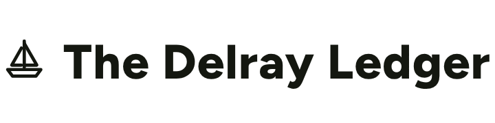
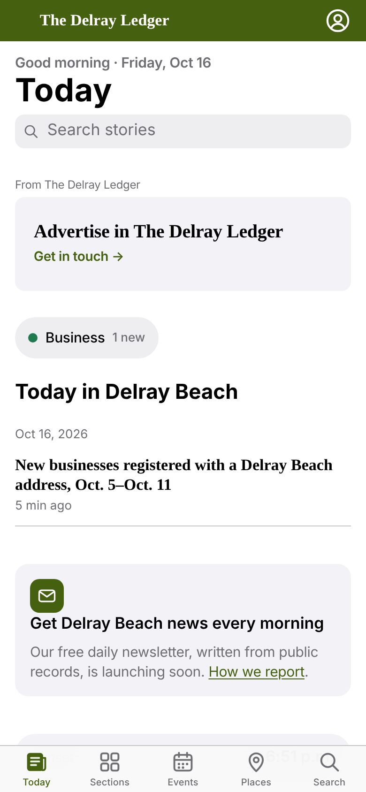
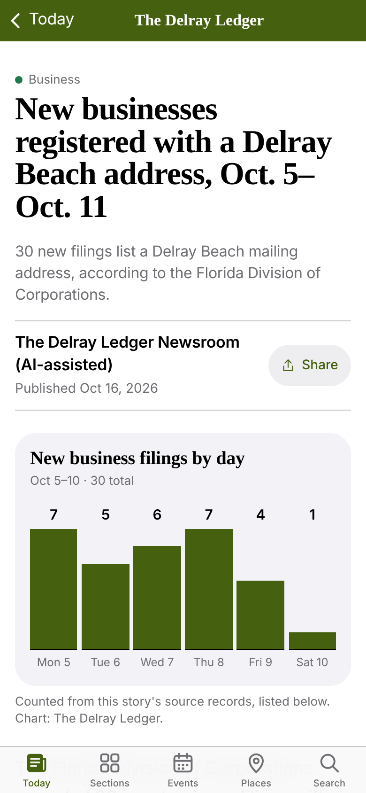
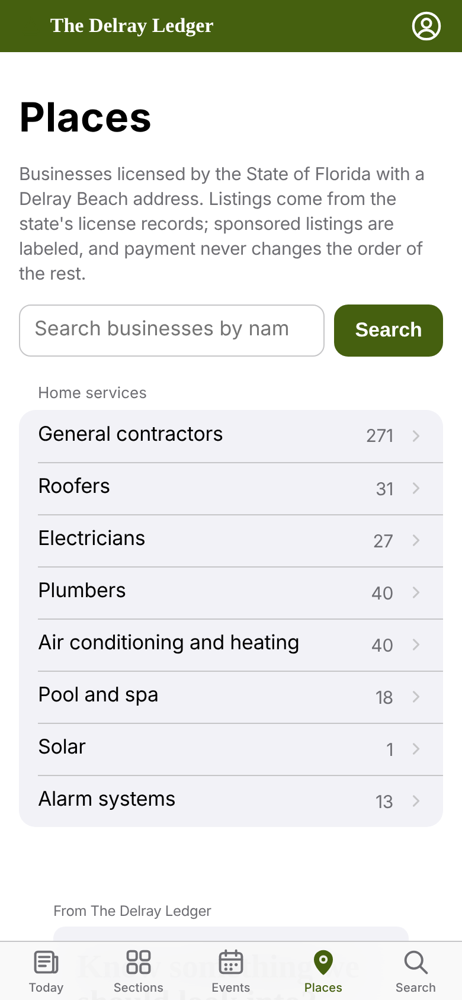
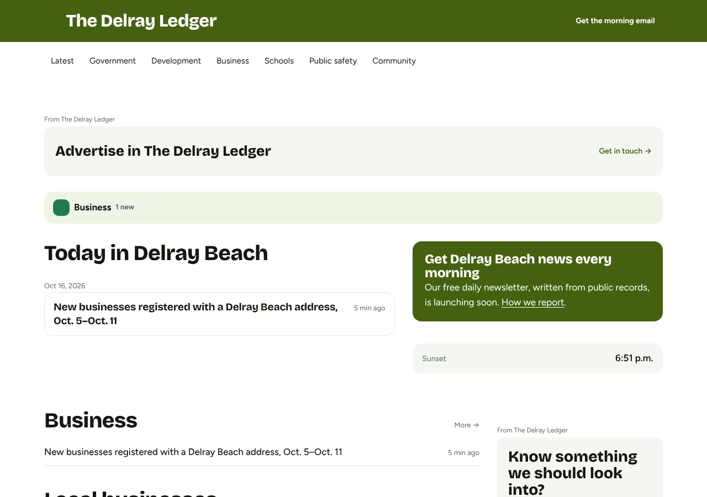
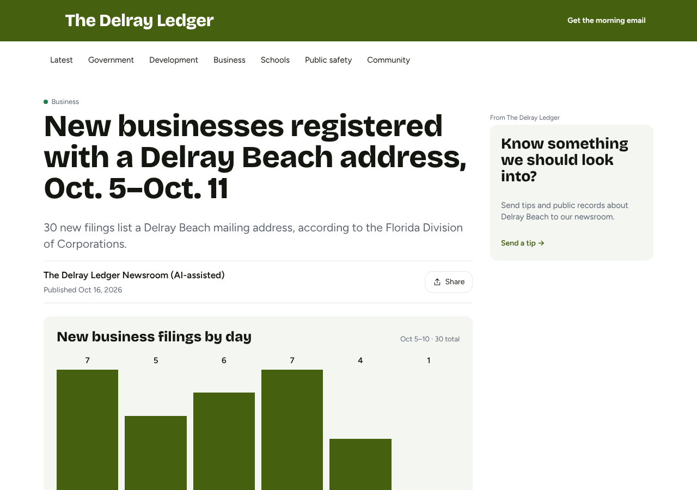
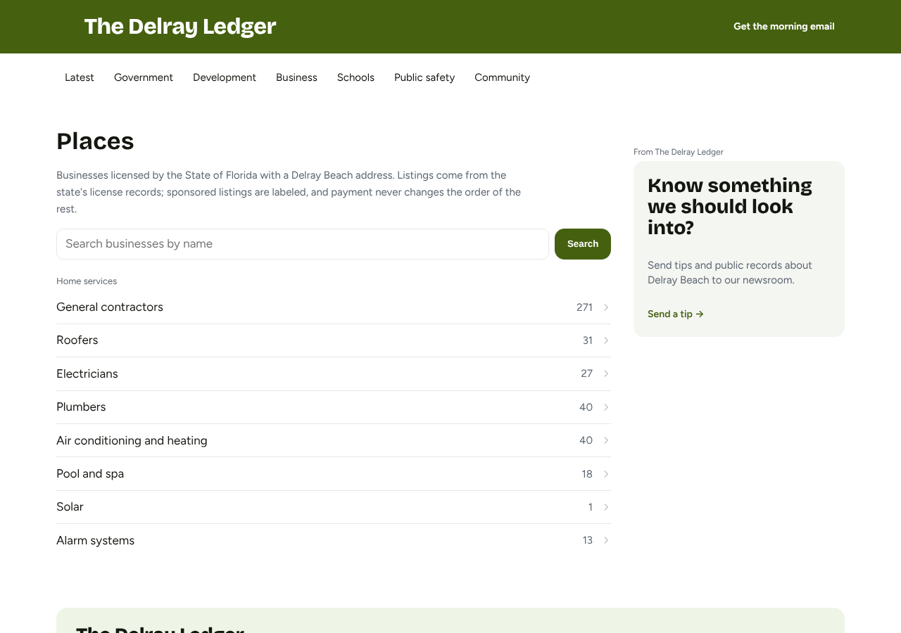
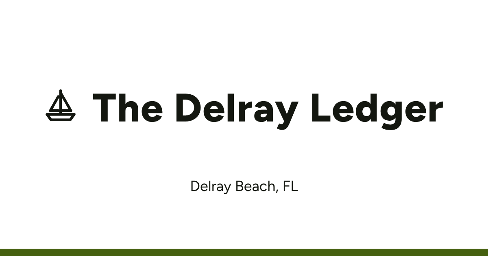

# Launch report: The Delray Ledger (Delray Beach, FL)

**Not passing yet:** see the checks below. The town is a draft (not indexed). An admin approves it in Admin → Launches after the manual to-dos; going live also needs the domain bought and the mail domain live (Rule 10).

## Automated checks

| Check | Result | Detail |
| --- | --- | --- |
| Readiness (Rule 7) | **Fail** | 0.2 real items a day; 3 needed (classified). |
| No TBD fields in the town config | Pass | Every field is set. |
| Name checks (§10b) | Pass | The Delray Ledger (delrayledger.com): no conflicts found |
| Theme valid, WCAG AA contrast | Pass | Every text pair passes. |
| Slot contract | Pass | The newsletter sign-up is among the first two modules on phones. |
| Neighbor rule (§11a-2) | Pass | Differs from Boca Town Square (6 mi). |
| Every page type renders | Pass | Rendered on phone and desktop: home, article, directory. |

## The town

- Census: Delray Beach city (1217100), Palm Beach County, 69,809 people (2025), tier mid
- Timezone America/New_York; NWS zone FLZ068 (office MFL) from the town's interior point. Check it covers the coast if the town is coastal.
- Same name elsewhere: none

## Name and domain

- Picked: **The Delray Ledger** at **delrayledger.com**
- Purchase: not bought (dry run (no --approve-spend))
- Other options: Delray Courier (delraycourier.com); Delray Daily (delraydaily.com, ruled out: delraydaily.com is taken); Delray Local (delraylocal.com, ruled out: delraylocal.com is taken)

## Sources

Discovery: manual (--source flags and state sources).

| Kind | URL | Result | Detail |
| --- | --- | --- | --- |
| business_filings | https://www.myfloridalicense.com/ | matched (fl-dbpr) | Florida DBPR contractor and trade licenses |
| business_filings | https://www.myfloridalicense.com/ | matched (fl-dbpr) | Florida DBPR new food service approvals |
| business_filings | https://sftp.floridados.gov/ | matched (fl-sunbiz) | Florida Division of Corporations daily filings |

Adapter requests: `adapter-requests.md`.

## Readiness (Rule 7)

0.2 real items a day over 30 days; 3 needed.

| Source | Ingest | Records in window | Items | How counted |
| --- | --- | --- | --- | --- |
| business_filings (fl-dbpr) | ok | 0 | 0 | 0 records in 0 weeks: one weekly roundup a week |
| business_filings (fl-dbpr) | ok | 3 | 2 | 3 records in 2 weeks: one weekly roundup a week |
| business_filings (fl-sunbiz) | ok | 40 | 4 | 40 records in 4 weeks: one weekly roundup a week |

## Seeded content

- Story finder: 1 roundups, 0 candidates, 0 accepted
- Directory: 441 active listings from state license data
- Guides: No guide topics mapped yet: map the network guide topics to official pages in the town YAML (guides:), verified live (D-M4-2).

Sample stories (on the draft site):
- [New businesses registered with a Delray Beach address, Oct. 5–Oct. 11](https://delrayledger.com/news/new-businesses-registered-with-a-delray-beach-address-oct-5-oct-11) (published)

## Theme

Generated without a model.

- Family **community**, brand color #45600F, motif sailboat, masthead left-motif
- Layout: header tinted-bar, grid main-right-rail, article classic-rail, directory search-first, footer community
- Identity notes: Generated without a model for Delray Beach, FL: identity research is still to do (see the launch report).

### Masthead options (pick one; the first is the theme's)

1. left-motif: 
2. centered-serif: 
3. ruled-nameplate: 

### Screenshots

Nearest towns: Boca Town Square (6 miles). Compare with their sites before approving.

### Identity assets

- facebook-cover: 
- share-default: 
- social-avatar: 
- newsletter-header: 

## Provisioning (dry run)

- Stripe test prices: enhanced $39/month (create), sponsored_slot $199/month (create)
- Mail domain: not onboarded
- Newsletter: off: an admin switches it to test, then live after 3 test issues (D-M5-2)

## Manual to-dos

- [ ] Readiness is 0.2 a day, below 3 (Rule 7): find more official sources the bot may read, or build the adapter requests, then resume with --source kind=url.
- [ ] Buy delrayledger.com (Rule 10): `pnpm launch "Delray Beach, FL" --resume --approve-spend`
- [ ] Stripe test prices for this town: `pnpm directory:stripe sync --town delray-beach --execute`
- [ ] Mail domain: SES identities and DNS on Vercel (Rule 10): `pnpm mail:onboard add delrayledger.com --execute --approved`
- [ ] Attach the domain to the Vercel web project (production deploy, Rule 10): `Vercel dashboard → Project → Domains → add delrayledger.com and www.delrayledger.com`
- [ ] Trademark: search the picked name at https://tmsearch.uspto.gov/ (D-M7-4).
- [ ] Social handles: claim the name on Facebook, Instagram and X by hand (D-M7-5); upload the identity assets.
- [ ] Facebook page for delrayledger.com, with the cover and avatar from identity/.
- [ ] Google News Publisher Center and Search Console for delrayledger.com (D-M4-6).
- [ ] Pick the masthead option above (the theme uses the first unless changed).
- [ ] Map the evergreen guide topics to official pages (guides: in the town YAML), then review the first batch (D-M4-2).
- [ ] Check the archive history of delrayledger.com by hand: https://web.archive.org/web/*/delrayledger.com
- [ ] Write identity notes for the theme (no model ran): landscape, architecture, signature places.
- [ ] Turn on Stripe live mode only when you decide (runbook "Going live", D-M6-5).

## AI cost of this launch

$0.00 (cap $25, D-M7-11)
